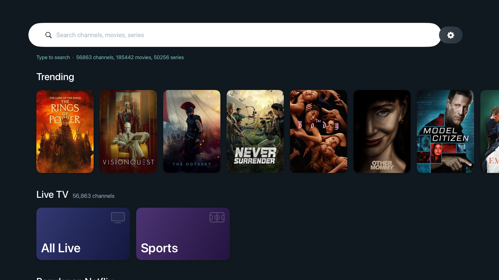
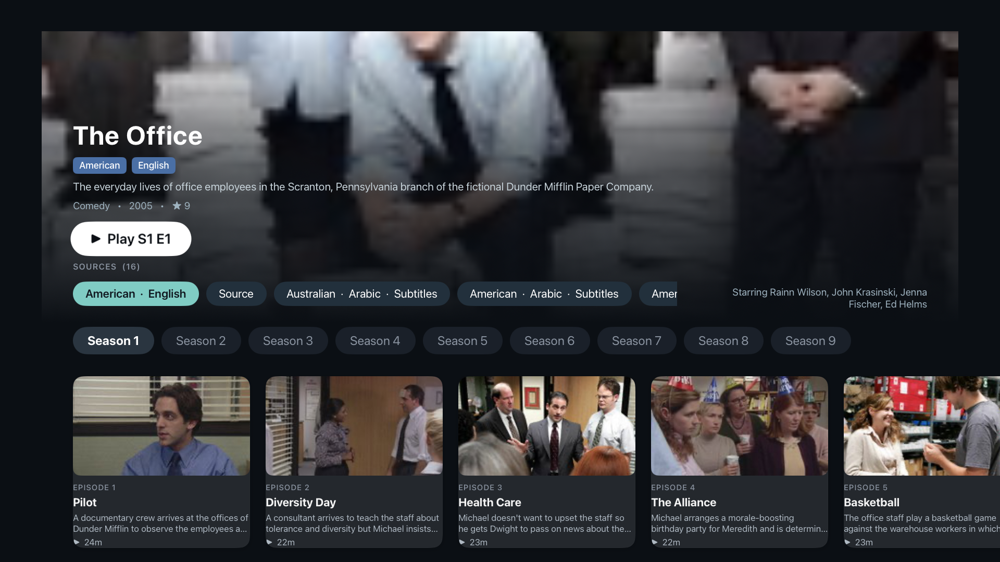
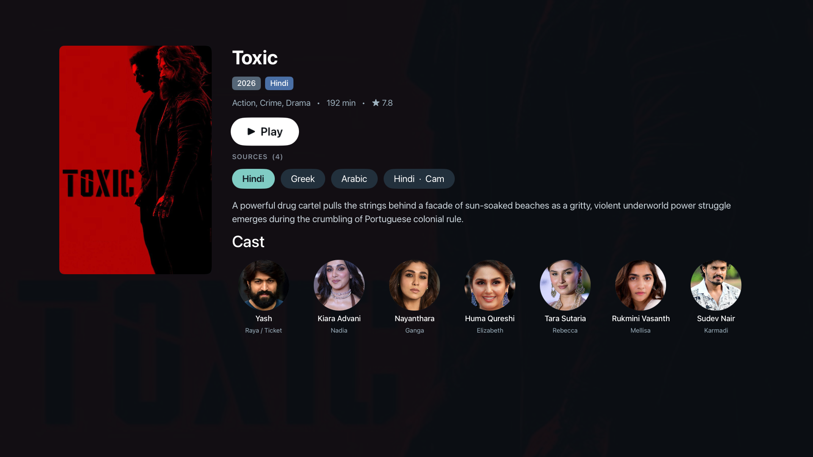
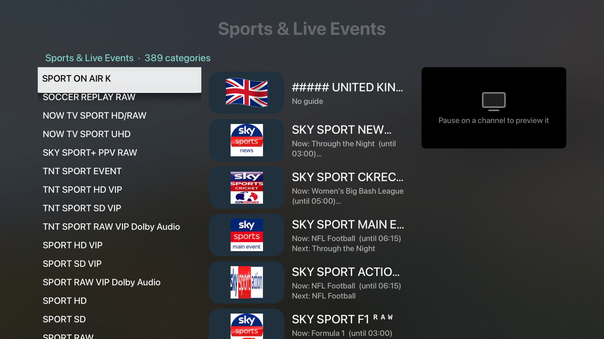
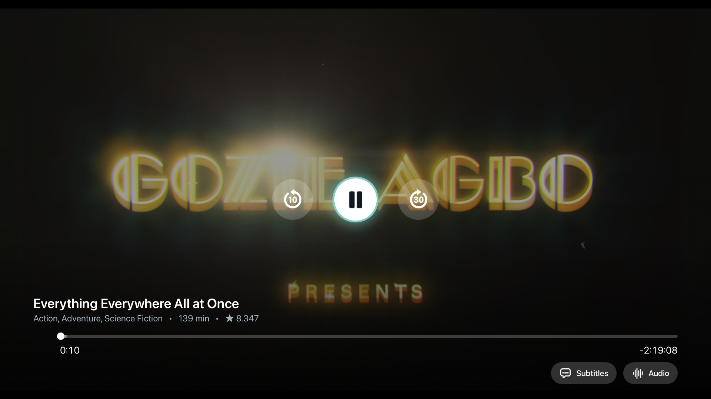
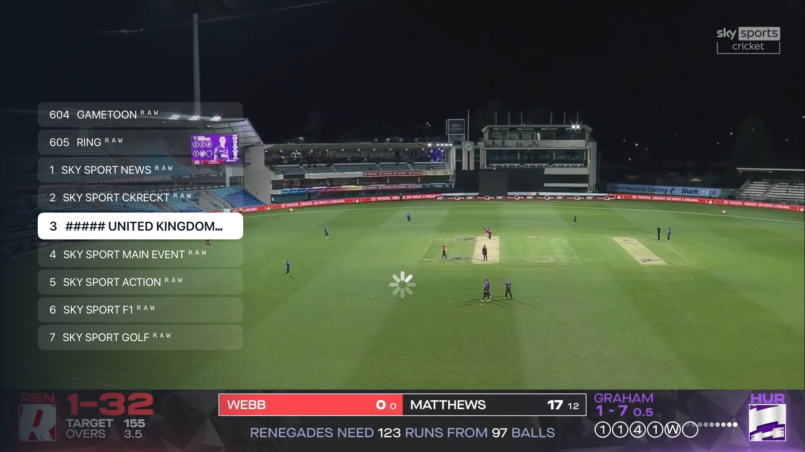

# Stream Everything

A player for Xtream Codes IPTV subscriptions on Google TV / Android TV (`app/`) and Apple TV (`appletv/`). Live TV with a guide and channel zapping, movies and series with resume and source switching, TMDB artwork and metadata, Watchmode popularity rails, and on Apple TV a local media cache so titles start instantly and seeks inside what is already downloaded are immediate.

<p>
  
  
</p>
<p>
  
  
</p>
<p>
  
  
</p>

You need your own Xtream Codes account. Each build has the credentials baked in, so a build is personal to one subscription; nothing in this repository contains an account or API key.

## 1. Get the credentials

You need five values. Collect them before building.

| Value | Where it comes from |
| --- | --- |
| `XTREAM_SERVER` | Your IPTV provider gives you a server URL with a port, for example `http://host.example:8080`. It is the same URL you would type into any Xtream Codes player. No trailing path. |
| `XTREAM_USER` | The username from the provider. |
| `XTREAM_PASS` | The password from the provider. |
| `TMDB_KEY` | Free. Create an account at https://www.themoviedb.org, then Settings > API > Create > Developer, and copy the **API Key (v3 auth)**, a 32-character hex string. Used for posters, backdrops, overviews, cast and the trending rail. |
| `WATCHMODE_KEY` | Free tier. Sign up at https://api.watchmode.com, copy the API key from the dashboard. Used only to rank the "Popular on Netflix / Prime / ..." rails. Optional: leave it empty and the rails are ordered by TMDB popularity instead. |

## 2. Put them in `xtream.properties`

Create a file named `xtream.properties` in the repository root (next to this README). It is listed in `.gitignore` and must never be committed.

```
XTREAM_SERVER=http://host.example:8080
XTREAM_USER=your_username
XTREAM_PASS=your_password
TMDB_KEY=0123456789abcdef0123456789abcdef
WATCHMODE_KEY=your_watchmode_key
```

One `KEY=value` per line, no quotes, no spaces around `=`. Both builds read this file:

- Android: Gradle reads it at build time and compiles the values into the app.
- Apple TV: `appletv/build-tv.sh` regenerates `appletv/StreamEverything/Sources/Credentials.swift` from it on every build (that file is gitignored too).

If you edit the file, rebuild; the apps do not read it at runtime.

## 3. Build for Google TV / Android TV

Requirements: JDK 17 and an Android SDK with platform 33. Tell Gradle where the SDK is with a `local.properties` file in the repository root (gitignored):

```
sdk.dir=/Users/you/Library/Android/sdk
```

Build:

```
./gradlew assembleDebug
```

The APK is written to `app/build/outputs/apk/debug/app-debug.apk`.

Install on the TV over Wi-Fi (enable Developer options > USB debugging / Wireless debugging on the TV first):

```
adb connect <tv-ip>:5555
adb install -r app/build/outputs/apk/debug/app-debug.apk
```

Building for someone else: put only their three `XTREAM_*` lines in `build-profiles/<name>.properties` (gitignored) and run `./build-for.sh <name>`. The script swaps those three values into `xtream.properties`, builds, restores your own file, and leaves the APK in `rollback/StreamEverything-<name>.apk`. Your TMDB and Watchmode keys are kept.

## 4. Build for Apple TV

Requirements:

- Xcode 26 or later, with your Apple ID added under Xcode > Settings > Accounts.
- [xcodegen](https://github.com/yonaskolb/XcodeGen): `brew install xcodegen`.
- The TVVLCKit binary from VideoLAN. Download a TVVLCKit 3.x archive from https://download.videolan.org/pub/cocoapods/prod/ and unpack it so this path exists: `appletv/Frameworks/TVVLCKit-binary/TVVLCKit.xcframework` (the `Frameworks` folder is gitignored).

One-time setup:

1. Open `appletv/project.yml` and set `DEVELOPMENT_TEAM` to your team ID (Xcode > Settings > Accounts > your team > the ID shown in the details).
2. Pair the Apple TV with the Mac: on the TV open Settings > Remotes and Devices > Remote App and Devices and leave that screen open; in Xcode open Window > Devices and Simulators, select the TV under Discovered, click Pair and type the code the TV shows. Both must be on the same network.

Build, install and launch on the TV:

```
cd appletv
./build-tv.sh                # targets the Apple TV named "Living Room"
./build-tv.sh "Bedroom TV"   # another device name
```

The script writes `Credentials.swift`, runs xcodegen, builds Release, installs with `devicectl` and launches the app.

Simulator: `appletv/sim.sh` wraps the common steps.

```
./sim.sh build                          # build and install into the Apple TV 4K simulator
./sim.sh launch --no-prefetch           # launch; --no-prefetch keeps the simulator off your stream slot
./sim.sh launch --movie=<id>            # open straight on a movie page (also --series=<id>)
./sim.sh key down 2 && ./sim.sh shot    # press remote keys, take a screenshot
```

Most Xtream accounts allow one connection at a time. Do not stream in the simulator while the TV is playing, and use `--no-prefetch` in the simulator so page prefetches do not take the slot.

## Using the apps

- Home shows trending titles, Live TV tiles (favorites, all channels, sports, and the languages you watch), Continue Playing, and a "Popular on" rail per streaming service, ordered by what you watch most.
- A movie or series page lists every copy the provider has as **source** pills (language, quality, service tag). Switching sources keeps your position when the copies are the same length.
- In the player: Left/Right seek (hold to accelerate), Up/Down move between the transport buttons, the time bar and the option pills, Menu hides what is on screen first and leaves on the next press. Subtitles and audio tracks are picked from their pills; the title and poster appear when paused.
- Live TV: Up/Down zap through the list you opened the channel from, with the channel column shown on the left while you step; Select shows it again. Long-press a channel in the guide to add it to favorites or remove it from the lists (removed channels gather under "Removed" and can be put back).
- Apple TV caches what you play (last 10 titles, 7 days) and prefetches the page in front of you (up to 200 MB for 30 minutes), so replays and resumes start from disk. While something plays, nothing else downloads.

## Repository layout

- `app/` Android TV app (Kotlin, ExoPlayer).
- `appletv/` tvOS app (SwiftUI + a UIKit player on TVVLCKit), `project.yml` for xcodegen, `build-tv.sh`, `sim.sh`.
- `docs/screenshots/` the images above (taken in the tvOS simulator).
- `analysis/` scripts used while tuning catalog parsing and artwork (the catalog dumps they read are not published).
- `prototype/` throwaway scripts used to measure provider behaviour.

## License

No license is granted yet; all rights reserved by the author. Open an issue if you want to use the code.
